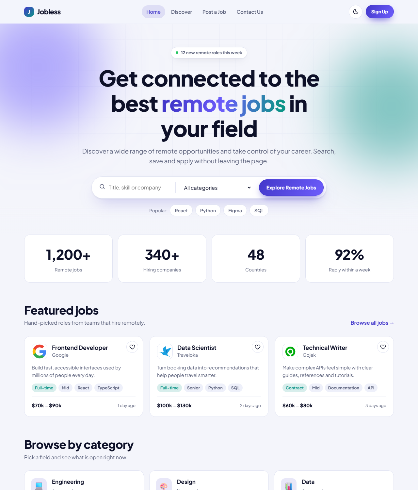

# Jobless

A remote job board, redesigned from my first Figma-to-code practice project ([Code The Design challenge](https://codedesign.dev/challenge/jobless)). It started as a static slice of a design and is now an interactive, responsive, accessible site with live listings.

**Live:** https://jobless-sigma.vercel.app



## What you can do

- **Browse live remote jobs** pulled from the [Remotive](https://remotive.com) public API. Apply takes you to the original posting.
- **Search and filter** by keyword, category, type, level and minimum salary, with sorting and a shareable URL (`discover.html?q=react&category=Engineering`).
- **Save jobs** with the heart button and view only saved ones.
- **Open a job** to read the details and copy a link to it.
- **Post a job** with a live preview that updates as you type. Posted jobs appear on Discover (this browser only).
- **Contact form** with inline validation, plus an FAQ.
- **Light and dark theme**, following the system setting with a manual toggle.

## How the data works

`/api/jobs` is a small Vercel serverless function (`api/jobs.js`) that calls Remotive, normalises the response (category, job type, salary text, level, tags, age) and returns JSON.

- Remotive asks for at most about 4 requests per day, so the response is cached on Vercel's CDN for 6 hours (`s-maxage=21600`). Visitors never hit Remotive directly.
- Attribution: every job links back to its Remotive page, and the source is named on Home, Discover and in the job dialog.
- Remotive only exposes a small public sample (around 16 jobs) and delays listings by 24 hours.
- Salary is shown as written in the listing. Annual figures are parsed for the salary filter and sorting; hourly rates are not.
- Level (Junior, Mid, Senior) is estimated from the job title because Remotive does not provide it.
- If the feed is unavailable, the site falls back to demo listings in `data.js` and says so.
- The client also caches the feed in `localStorage` for 30 minutes.

## Details

- Plain HTML, CSS and JavaScript on the front end. No build step and no dependencies.
- Responsive from 320 px phones to wide desktops, keyboard accessible, visible focus, skip link, respects `prefers-reduced-motion`.
- Saved jobs, posted jobs and theme live in `localStorage` only. Contact, sign-up and demo applications send nothing anywhere.
- All text from outside (API data and form input) is escaped before it is rendered, and job descriptions are reduced to plain text on the server.

## Run locally

The front end works with any static server (`npx serve`), but `/api/jobs` needs the Vercel runtime, so use:

```bash
npx vercel dev
```

Without it the site still works and shows the demo listings.

## Structure

```
index.html  discover.html  post-job.html  contact.html
api/jobs.js       Remotive proxy with caching
css/style.css     design tokens, layout, components
data.js           demo listings (fallback) and categories
main.js           shared layout, theme, dialogs, feed loading, and each page's behaviour
```

## Deploy

Hosted on Vercel. The static files are served as-is and `api/` is deployed as a serverless function.
